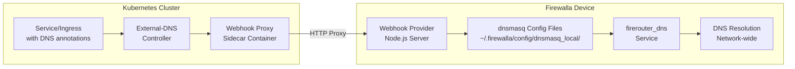

# external-dns-firewalla-webhook

A webhook provider for [external-dns](https://github.com/kubernetes-sigs/external-dns) that manages DNS records on Firewalla devices via dnsmasq configuration files.

## Overview

This project enables external-dns to automatically manage DNS records on your Firewalla device for services running in Kubernetes. It consists of two components:

1. **Webhook Provider**: A Node.js service that runs directly on your Firewalla device
2. **Webhook Proxy**: A lightweight HTTP proxy that runs as a sidecar container in your external-dns Kubernetes deployment

## Architecture



## Prerequisites

- Firewalla device (Gold, Purple, Red, or any model with SSH access)
- Firewalla firmware with Node.js at `/home/pi/firewalla/bin/node`
- Kubernetes cluster with external-dns installed
- SSH access to your Firewalla device as the `pi` user
- Sudo privileges on Firewalla

## Quick Start

Each steps needs to be ran on either your firewalla device or your Kubernetes cluster. The headers tell you where you should run it.

```diff
+ Security Notice
+ This project uses JWT authentication with a shared secret between the webhook proxy
+ and the Firewalla provider. Ensure your SHARED_SECRET is strong and kept secure.
+ Only expose the webhook proxy to trusted networks within your Kubernetes cluster.
```

### 1. Install the Webhook Provider (Firewalla)

Run the reviewed installer as `pi`. It refuses an existing installation or systemd unit and preserves existing DNS files. Inspect a partial installation before retrying; the installer never deletes it.

Create private input files. For a new installation only, generate a shared secret:

```bash
umask 077
install_inputs=$(mktemp -d)
printf '%s\n' 'home.local,*.home.local' > "$install_inputs/domain"
openssl rand -hex 32 > "$install_inputs/secret"
```

For restoration, reuse the existing Kubernetes shared secret instead. Transfer it on stdin into the private secret file without printing it or putting it in a command argument. The file must be owned by `pi`, mode `0600`, and contain at least 32 letters, digits or `._~+/=-` characters. The installer rejects unsupported input instead of silently changing the credential.

Use an inspected source archive or checkout containing the bundled `node_modules`, with no `.env` file:

```bash
reviewed_source=/path/to/reviewed/source
bash "$reviewed_source/scripts/install.sh" \
  --source-dir "$reviewed_source" \
  --config-file "$install_inputs/domain" \
  --secret-file "$install_inputs/secret"
```

Omitting `--source-dir` clones the current default branch. An explicit source directory keeps restoration tied to the revision you reviewed. No package installation is needed on Firewalla.

The installer validates the candidate sudoers rule, creates the provider directory and a `0600` environment file, installs its systemd unit, and enables and starts only the provider. An existing, different sudoers rule stops installation. After loading the unit, it also rejects an explicitly configured `NoNewPrivileges` restriction that would block the sudo restart helper. The supplied unit has no directives that implicitly enable this restriction; inspect any host-specific drop-ins before installation. It does not directly restart DNS, but the running provider restarts `firerouter_dns` when external-dns submits record changes. This can briefly interrupt DNS resolution.

After verifying provider health and DNS reconciliation, remove the private input directory you created. Input files remain available after a failed attempt for controlled recovery.

Run installer regression checks locally with `npm run test:installer` and `shellcheck scripts/install.sh`. Tests use temporary directories and mocked privileged commands; they do not contact Firewalla.

### 2. Configure External-DNS (Kubernetes)

Use the example helm values:

```yaml
# Use webhook provider
provider:
  name: webhook
  webhook:
    image:
      repository: ghcr.io/theoutdoorprogrammer/external-dns-firewalla-webhook
      tag: 1.1.0
    env:
       - name: FIREWALLA_HOST
         value: "192.168.229.1"
       - name: FIREWALLA_PROVIDER_PORT
         value: "8888"
       - name: FIREWALLA_HEALTH_PORT
         value: "8080"
       - name: WEBHOOK_PORT
         value: "8888"
       - name: METRICS_PORT
         value: "8080"
       - name: SHARED_SECRET # You can use a secret reference, must match Firewalla shared secret (recommended)
         valueFrom:
            secretKeyRef:
               name: firewalla-webhook-secret
               key: shared-secret
#       - name: SHARED_SECRET # Or manually set the shared secret (not recommended)
#         value: "your-secure-shared-secret-here"
    livenessProbe:
      httpGet:
        path: /health
        port: 8080
      initialDelaySeconds: 10
      timeoutSeconds: 5
    readinessProbe:
      httpGet:
        path: /ready
        port: 8080
      initialDelaySeconds: 10
      timeoutSeconds: 5

# Domain filter - must match Firewalla webhook configuration
domainFilters:
  - home.local

# Source configuration - what Kubernetes resources to watch
sources:
  - service
  - ingress

# Policy settings
policy: sync
registry: txt
txtOwnerId: home-k8s-cluster

# TXT record prefix
extraArgs:
  - --txt-prefix=external-dns-

# Logging
logLevel: info
logFormat: text

# Resources
resources:
  requests:
    cpu: 50m
    memory: 64Mi
  limits:
    cpu: 200m
    memory: 128Mi

# Single replica is sufficient for home lab
replicaCount: 1

# Service account
serviceAccount:
  create: true

# RBAC
rbac:
  create: true
```

Heres a quick way to create the above secret if you use the recommended approach:
```bash
kubectl create secret generic firewalla-webhook-secret --from-literal=shared-secret="{your-secure-shared-secret-here}"
```

## Configuration

### Webhook Provider (Firewalla)

Configure via `/opt/external-dns-firewalla-webhook/.env`:

```bash
DOMAIN_FILTER=home.local,*.home.local
SHARED_SECRET=your-secure-shared-secret-here
PORT_PROVIDER=8888
PORT_HEALTH=8080
DNS_TTL=300
DNSMASQ_DIR=/home/pi/.firewalla/config/dnsmasq_local
LOG_LEVEL=info
DRY_RUN=false
RESTART_COMMAND=sudo systemctl restart firerouter_dns
```

### Webhook Proxy (Kubernetes)

Environment variables for the sidecar container:

- `FIREWALLA_HOST`: IP address of your Firewalla device
- `FIREWALLA_PROVIDER_PORT`: Provider API port on Firewalla (default: 8888)
- `FIREWALLA_HEALTH_PORT`: Health check port on Firewalla (default: 8080)
- `WEBHOOK_PORT`: Port for webhook proxy to listen on (default: 8888)
- `METRICS_PORT`: Port for health/metrics endpoints (default: 8080)
- `SHARED_SECRET`: Shared secret for JWT authentication (must match Firewalla provider)

## Supported Record Types

- A records (IPv4 addresses)
- CNAME records (domain aliases)
- TXT records (for external-dns ownership tracking)

## API Endpoints

The webhook provider exposes these endpoints:

- `GET /`: Domain filter negotiation with external-dns
- `GET /records`: Retrieve current DNS records
- `POST /records`: Apply DNS record changes
- `POST /adjustendpoints`: Filter unsupported record types
- `GET /healthz`: Health check endpoint

## DNS Record Storage

DNS records are stored as individual files in `/home/pi/.firewalla/config/dnsmasq_local/`:

```
example.home.local
├── address=/example.home.local/192.168.1.100
└── address=/example.home.local/192.168.1.101

api.home.local
└── cname=api.home.local,service.home.local
```

## Testing

1. Verify the webhook provider is running on Firewalla:
   ```bash
   sudo systemctl status external-dns-firewalla-webhook
   curl http://localhost:8080/healthz
   ```

2. Check external-dns pod status:
   ```bash
   kubectl get pods -n external-dns
   kubectl logs -n external-dns -l app=external-dns
   ```

3. Create a test service with DNS annotations:
   ```yaml
   apiVersion: v1
   kind: Service
   metadata:
     name: nginx-test
     annotations:
        external-dns.alpha.kubernetes.io/hostname: nginx.home.local
   spec:
     type: LoadBalancer
     ports:
     - port: 80
     selector:
       app: nginx
   ```

## Troubleshooting

### Common Issues

1. **Service won't start on Firewalla**
   - Check logs: `sudo journalctl -u external-dns-firewalla-webhook -n 50`
   - Verify Node.js: `/home/pi/firewalla/bin/node -v`
   - Check .env file: `cat /opt/external-dns-firewalla-webhook/.env`

2. **DNS records not created**
   - Verify domain filter matches between Firewalla and external-dns
   - Check external-dns logs for connectivity issues
   - Test network connectivity from Kubernetes to Firewalla

3. **DNS service restart fails**
   - Check sudo permissions: `sudo -l | grep firerouter_dns`
   - Test manually: `sudo systemctl restart firerouter_dns`

## Development

1. Clone the repository
2. Install dependencies: `npm install`
3. Copy `.env.example` to `.env` and configure
4. Run in development mode: `npm run dev`

## License

MIT
